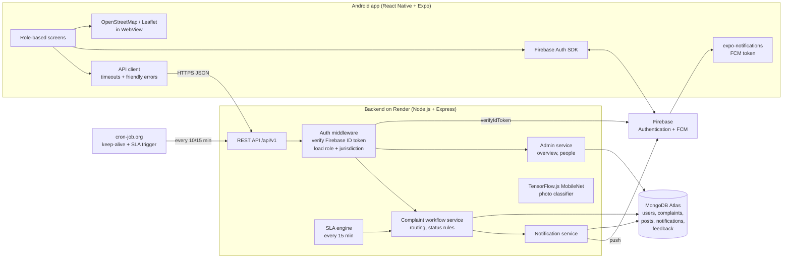
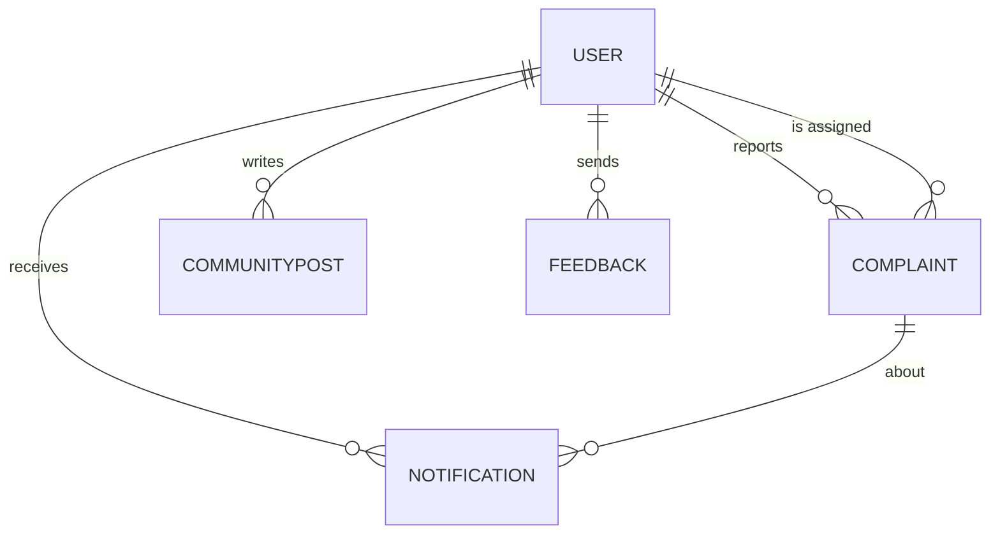
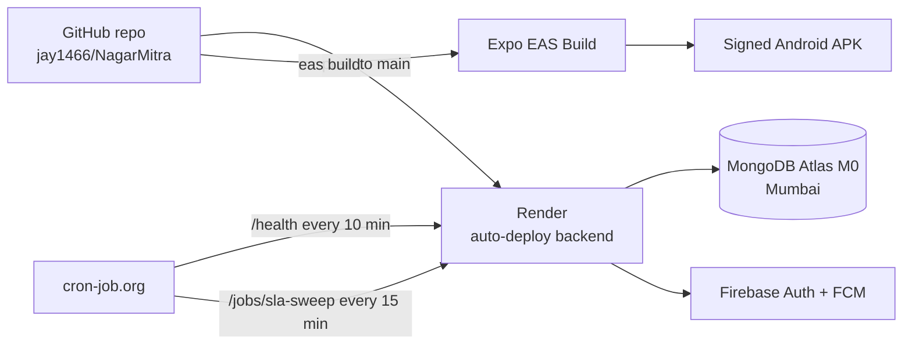

# NagarMitra — Smart Civic Issue Reporting & Resolution Platform

> **जन की आवाज, सरकार का समाधान** — *Voice of the People, Government's Solution*

| | |
|---|---|
| **Project type** | Mobile Application Development (MAD) project |
| **Platform** | Android (React Native / Expo), Node.js REST backend |
| **Current version** | v1.2.1 (released 25 October 2026) |
| **Student** | _Your name, enrolment no., class/division_ |
| **Guide** | _Faculty name_ |
| **Institute** | _Institute name_ |
| **Source code** | https://github.com/jay1466/NagarMitra |
| **Live backend** | https://nagarmitra-backend.onrender.com |
| **Android APK (v1.2.1)** | https://expo.dev/artifacts/eas/fjoNrBQ8fvzmqJlxg4nts53gYnbfv3VStQhpfezwSg8.apk |

---

## Table of Contents

1. [Abstract](#1-abstract)
2. [Introduction](#2-introduction)
3. [Problem Statement](#3-problem-statement)
4. [Objectives](#4-objectives)
5. [Scope](#5-scope)
6. [Study of Existing Systems](#6-study-of-existing-systems)
7. [Proposed System](#7-proposed-system)
8. [Users & Roles](#8-users--roles)
9. [Features](#9-features)
10. [System Architecture](#10-system-architecture)
11. [Technology Stack](#11-technology-stack)
12. [Complaint Workflow](#12-complaint-workflow)
13. [Routing, SLA & Escalation](#13-routing-sla--escalation)
14. [Access Control](#14-access-control)
15. [Database Design](#15-database-design)
16. [REST API](#16-rest-api)
17. [Mobile App Screens](#17-mobile-app-screens)
18. [Notifications](#18-notifications)
19. [Security](#19-security)
20. [Deployment](#20-deployment)
21. [Testing](#21-testing)
22. [Bugs Found & Fixed](#22-bugs-found--fixed)
23. [Version History](#23-version-history)
24. [Demo Data & Accounts](#24-demo-data--accounts)
25. [Installation & Setup](#25-installation--setup)
26. [Project Statistics](#26-project-statistics)
27. [Limitations](#27-limitations)
28. [Future Scope](#28-future-scope)
29. [Conclusion](#29-conclusion)
30. [Acknowledgements](#30-acknowledgements)
31. [References](#31-references)
32. [Appendix A — Presentation Outline](#appendix-a--presentation-outline)
33. [Appendix B — Report Chapter Mapping](#appendix-b--report-chapter-mapping)
34. [Appendix C — Viva Questions & Answers](#appendix-c--viva-questions--answers)

---

## 1. Abstract

Urban residents in India face everyday civic problems such as potholes, overflowing garbage, broken street lights, water-supply failures and blocked drains. Reporting them usually means visiting an office, calling a helpline, or posting on social media, with no reference number, no visibility of who is responsible and no follow-up.

**NagarMitra** is an Android application with a cloud backend that lets any citizen report a civic issue in under a minute with a photo, GPS location, category and priority. Each report receives a unique report ID and is **automatically routed** to the officer of the responsible department (Roads, Sanitation, Water, Electricity or General Administration) in the citizen's **district**. Every complaint carries a **service-level deadline (SLA)** based on its category and priority. If the deadline is missed, the system **reminds the officer and escalates** the complaint up an administrative ladder: District Admin → State Master Admin → Super Admin (India).

The platform models the real Indian administrative hierarchy across **36 States/UTs and 784 districts**. Each role sees only its own jurisdiction. Citizens track their complaints on a timeline, get notified at every step (including push notifications while the app is closed), confirm or reopen resolved issues, rate the fix, and take part in a community feed. Administrators get dashboards with overdue and escalated counts and officer performance.

---

## 2. Introduction

Smart-city initiatives depend on fast, transparent feedback loops between citizens and municipal bodies. Government platforms such as **CPGRAMS** (central grievances) and **Swachhata** (sanitation) prove that digital grievance redressal works at national scale. They share a common pattern:

1. a unique registration ID for every grievance,
2. automatic routing to the responsible officer,
3. time-bound resolution with automatic escalation, and
4. proof of resolution and citizen confirmation.

NagarMitra applies this pattern to everyday civic issues and puts it in a single mobile app for all three sides of the process: **citizens**, **field officers** and **administrators**.

---

## 3. Problem Statement

> **Domain:** Green Infrastructure & Smart Cities

1. **No easy reporting channel.** Citizens do not know where or how to report civic issues.
2. **No accountability.** Complaints are not assigned to a named officer, so nobody owns them.
3. **No transparency.** Citizens cannot see the status, the responsible person or the deadline.
4. **No time limits.** Complaints stay open indefinitely; there is no escalation when they are ignored.
5. **No data for authorities.** Administrators cannot see backlogs, hotspots or officer performance.
6. **Scattered jurisdiction.** Issues must reach the right department in the right district, not a single central inbox.

---

## 4. Objectives

- Provide a **one-minute reporting flow**: photo, GPS location, category and priority.
- **Automatically route** every complaint to the correct department officer in the correct district.
- Enforce **deadlines (SLAs)** with **reminders and multi-level escalation**.
- Give citizens **full transparency**: report ID, assigned officer, deadline and timeline.
- Let citizens **confirm, rate or reopen** a resolution.
- Give each administrative level a **dashboard for its own jurisdiction only**.
- **Notify** every stakeholder at every step, including when the app is closed.
- Build a **community space** for civic discussion.
- Keep the system **secure, reliable and free to run** for a pilot deployment.

---

## 5. Scope

**In scope**
- Android mobile app for citizens, officers and administrators (single app, role-based UI)
- India-wide geography: 36 States/UTs, 784 districts (State → District selection)
- Five departments: Roads & Potholes, Sanitation & Waste, Water Supply, Electricity & Street Lights, General Administration
- Six complaint categories: Potholes, Sanitation, Waste Management, Water Supply, Electricity & Lighting, Miscellaneous
- Complaint lifecycle, SLA engine, escalation, notifications, community feed, feedback
- Cloud deployment on free tiers

**Out of scope (current version)**
- Ward/zone level below districts (for example GIS ward polygons)
- iOS build (the code is cross-platform, but only Android was built and tested)
- Integration with existing government systems (CPGRAMS, Open311)
- Payments or other paid municipal services

---

## 6. Study of Existing Systems

| System | Who runs it | What it does well | Gap that NagarMitra addresses |
|---|---|---|---|
| **CPGRAMS** | Govt. of India (DARPG) | Unique ID, auto-routing to the grievance officer, 21-day disposal limit, automated escalation | National/ministry focus, not hyper-local civic issues; heavy web forms |
| **Swachhata app** | MoHUA | Photo complaint, 12-hour sanitation SLA, 24-hour response, escalation, resolution photo, citizen can reopen | Sanitation only |
| **FixMyStreet** | mySociety (UK) | Map-based reporting, public reports, Open311 standard | Not designed for India's state/district hierarchy |
| **SeeClickFix** | CivicPlus (US) | Comments, voting, "watch areas", Open311 integration | Commercial and US-centric |
| **Social media / helplines** | — | Easy to reach | No tracking ID, no owner, no SLA |

**Design decisions taken from this study**
- Every complaint gets a **unique report ID** (like CPGRAMS).
- **Category SLAs and automatic escalation** (like Swachhata).
- **Resolution with a photo and citizen confirm/reopen** (like Swachhata).
- **Public, anonymised visibility** of issues for transparency (like FixMyStreet).
- **Community voting and discussion** (like SeeClickFix).

---

## 7. Proposed System

```
Citizen reports ──► Report ID generated ──► Department + district identified
        │                                              │
        │                                  Least-loaded officer auto-assigned
        │                                              │
        ▼                                              ▼
 Tracks timeline ◄── notifications ◄── Officer: acknowledge → work → resolve (photo)
        │                                              │
 Confirm (★ rating) / Reopen                SLA engine: remind officer → escalate
        │                                    District Admin → State Admin → Super Admin
        ▼
      Closed
```

**Key ideas**
- **Single app, five roles.** The UI adapts to the logged-in user's role.
- **Jurisdiction-first.** Every query on the server is filtered by the caller's state, district and department.
- **Deadline-driven.** Every open complaint has a due time; a background engine enforces it.
- **Transparent and accountable.** A full audit trail records who did what and when.

---

## 8. Users & Roles

| Role | Jurisdiction | Can do |
|---|---|---|
| **Super Admin (India)** | Whole country | See everything; overview by state; manage State Admins and below; receives escalations after 7 days overdue |
| **State Master Admin** | One state/UT | See all complaints in the state; overview by district; manage District Admins, officers, citizens in the state; receives escalations after 3 days overdue |
| **District Admin** | One district | See all complaints in the district; overview by department and officer performance; reassign complaints; create/manage officers; receives escalations after 24 hours overdue and alerts for unassigned complaints |
| **Department Officer** | One department in one district | Work queue of their own complaints only; acknowledge, start work, resolve with proof photo, reject with reason |
| **Citizen** | Home district (changeable) | Report issues, track own complaints, confirm/rate/reopen, remind officer, community posts, feedback |

**Rule:** a user can only create or manage accounts **strictly below** their own role and **inside** their own jurisdiction.

---

## 9. Features

### 9.1 Citizen
- Email sign-up/login (Firebase Authentication) with validation, show/hide password and password reset
- **Raise complaint:** up to 3 photos (camera or gallery, auto-compressed), description (minimum 10 characters), category, priority, **State → District dropdowns** auto-filled from GPS, optional street/landmark
- **AI category suggestion** from the first photo (TensorFlow.js MobileNet on the server)
- "Will be sent to the Roads officer of Anand, Gujarat" **routing preview** before submitting
- **My reports** with status badges and deadline ("Due in 5h" / "Overdue by 2d")
- **Complaint detail:** photos, map, assigned officer and designation, deadline, full **timeline**
- **Confirm fixed** with a 1–5★ rating, **Reopen** within 7 days with a reason, **Remind officer** (once every 24 hours)
- **Dashboard:** public issue map (markers/heatmap), statistics, switch between My district / My state / All India, track any report by ID
- **Community:** posts with photo, category, location, anonymous option; like, up/down-vote, share, delete own; **stories** from the last 24 hours
- **Notifications inbox** with unread badges, mark read, tap to open the complaint
- Profile (name, phone, photo, home state/district, address), Settings, FAQ, Feedback, About

### 9.2 Officer
- **Work Queue** limited to their department in their district, sorted by escalation and nearest deadline
- Summary cards: Open, Overdue, Escalated; filters: Open, Overdue, Escalated, Awaiting citizen, Resolved & closed, Rejected, All
- Actions: **Acknowledge → Start work → Mark resolved** (note + proof photo) or **Reject** (reason required)
- Reminders for overdue complaints; alerts when citizens reopen or nudge

### 9.3 Administrators (District / State / Super)
- **Overview** for their jurisdiction: Total, Open, Overdue, Escalated, Unassigned, Resolved, Rejected (each tile opens the matching list)
- **Breakdown** one level down: Super Admin by state → State Admin by district → District Admin by department, with progress bars
- **Officer performance** (District Admin): open, overdue, done, average citizen rating
- **Reassign** a complaint to another officer of the same department and district
- **Manage people:** search, filter by role, **create accounts**, change role/jurisdiction/department/designation, activate/deactivate

### 9.4 System
- Automatic routing, SLA deadlines, reminders, multi-level escalation, auto-close after 7 days
- Push notifications via Firebase Cloud Messaging, plus in-app inbox and polling fallback
- Per-screen crash guards ("Something went wrong — Try again") instead of app crashes
- Friendly network error messages, timeouts that tolerate server wake-up, retry buttons

---

## 10. System Architecture



**Request flow (example: citizen submits a complaint)**
1. The app gets a Firebase ID token for the logged-in user and sends `POST /api/v1/complaints` with the token.
2. The middleware verifies the token with Firebase Admin and loads the user's role and jurisdiction from MongoDB.
3. The server validates input (description length, category, priority, valid state + district) and stores compressed photos.
4. It generates the report ID (`NM-<STATE>-<YYYYMMDD>-<SEQ>`), maps category → department, and computes deadlines.
5. It finds active officers of that department in that district and assigns the one with the fewest open complaints.
6. It notifies the citizen ("registered") and the officer ("assigned") in the inbox and by push.

---

## 11. Technology Stack

| Layer | Technology | Why |
|---|---|---|
| Mobile app | **React Native 0.81, Expo SDK 54**, JavaScript | One codebase, fast development, cloud APK builds |
| Navigation | React Navigation 7 (bottom tabs + native stacks) | Role-based tabs, nested stacks |
| Maps | **Leaflet + OpenStreetMap** in `react-native-webview`, `leaflet.heat` | No API key or billing (Google Maps crashed the APK without a key) |
| Device APIs | expo-location, expo-image-picker, expo-image-manipulator, expo-notifications | GPS, camera/gallery, photo compression, push |
| Authentication | **Firebase Authentication** (email/password) | Secure, free, password reset |
| Push | **Firebase Cloud Messaging** via `firebase-admin` | Notifications while the app is closed |
| Backend | **Node.js 20, Express 4** | REST API, middleware, simple deployment |
| Database | **MongoDB Atlas (M0)** with **Mongoose 8** | Flexible documents, geo indexes, aggregation for dashboards |
| AI | **TensorFlow.js + MobileNet v2** | Suggests a complaint category from the photo |
| Security | Helmet, express-rate-limit, CORS, input validation | Safe defaults for a public API |
| Logging | Winston, Morgan | Structured logs |
| Hosting | **Render** (free web service, Singapore) | Free HTTPS hosting from GitHub |
| Scheduler | **cron-job.org** | Keeps the free server awake; triggers SLA sweeps |
| Builds | **EAS Build** (Expo Application Services) | Cloud-built signed APK |
| Source control | Git + GitHub, tagged releases | Version history |

---

## 12. Complaint Workflow

```mermaid
stateDiagram-v2
  [*] --> submitted: citizen reports
  submitted --> assigned: auto-routing / admin assigns
  submitted --> acknowledged: officer
  assigned --> acknowledged: officer
  assigned --> in_progress: officer
  acknowledged --> in_progress: officer
  acknowledged --> resolved: officer (note + photo)
  in_progress --> resolved: officer (note + photo)
  submitted --> rejected: officer (reason)
  assigned --> rejected: officer (reason)
  acknowledged --> rejected: officer (reason)
  in_progress --> rejected: officer (reason)
  resolved --> closed: citizen confirms (★ rating)
  resolved --> assigned: citizen reopens (≤ 7 days, reason)
  resolved --> closed: auto-close after 7 days
  closed --> [*]
  rejected --> [*]
```



| Status | Meaning | Who moves it here |
|---|---|---|
| `submitted` | Registered, waiting for an officer | Citizen |
| `assigned` | Routed to an officer | System (auto) / admin |
| `acknowledged` | Officer has reviewed it | Officer / admin |
| `in_progress` | Work has started | Officer / admin |
| `resolved` | Fixed, waiting for the citizen's confirmation | Officer / admin (note required, photo recommended) |
| `closed` | Confirmed by the citizen or auto-closed | Citizen / system |
| `rejected` | Not actionable (reason required) | Officer / admin |

Invalid jumps (for example `assigned → resolved`) are rejected by the server. Every change is appended to `statusHistory` with the time, the actor's name and role, and a note: a complete audit trail.

---

## 13. Routing, SLA & Escalation

### 13.1 Category → department routing

| Category | Department |
|---|---|
| Potholes | Roads & Potholes |
| Sanitation | Sanitation & Waste |
| Waste Management | Sanitation & Waste |
| Water Supply | Water Supply |
| Electricity & Lighting | Electricity & Street Lights |
| Miscellaneous | General Administration |

**Assignment algorithm**
1. Find active officers with `role = officer`, the same `department`, `state` and `district`.
2. Count each officer's open complaints.
3. Assign to the officer with the **fewest open complaints** (load balancing).
4. If no officer exists, the complaint stays `submitted` and the **District Admin is alerted** to assign it manually.

### 13.2 Service levels (SLA)

| Category | Acknowledge within | Resolve within |
|---|---|---|
| Potholes | 24 h | 72 h |
| Sanitation | 12 h | 24 h |
| Waste Management | 12 h | 24 h |
| Water Supply | 12 h | 48 h |
| Electricity & Lighting | 12 h | 48 h |
| Miscellaneous | 24 h | 120 h |

**Priority factor:** Critical × 0.5 · High × 0.75 · Medium × 1 · Low × 1.5
*(Example: a Critical pothole must be resolved within 36 hours.)*

### 13.3 Escalation ladder

| When | What happens | Level |
|---|---|---|
| Resolve deadline passes | Officer gets a reminder (repeated every 12 h) | 1 |
| Overdue by 24 h | **District Admin** alerted | 2 |
| Overdue by 72 h | **State Master Admin** alerted | 3 |
| Overdue by 7 days | **Super Admin** alerted | 4 |
| Resolved for 7 days without the citizen's response | Auto-closed | — |

The SLA engine runs **every 15 minutes** inside the server and is also triggered by **cron-job.org** through a key-protected endpoint, so it keeps working after the free server has been asleep.

---

## 14. Access Control

| Action | Citizen | Officer | District Admin | State Admin | Super Admin |
|---|:-:|:-:|:-:|:-:|:-:|
| Report a complaint | ✅ | — | — | — | — |
| See own complaints (full detail) | ✅ | — | — | — | — |
| See public complaints (anonymised) | ✅ | ✅ | ✅ | ✅ | ✅ |
| Work queue | ❌ | own dept + district | own district | own state | all India |
| Change status | ❌ | in jurisdiction | in jurisdiction | in jurisdiction | ✅ |
| Reassign | ❌ | ❌ | in district | in state | ✅ |
| Confirm / reopen / remind | own only | ❌ | ❌ | ❌ | ❌ |
| Admin overview | ❌ | ❌ | district | state | India |
| Create/manage accounts | ❌ | ❌ | officers, citizens | district admins and below | everyone below |

**Privacy:** the public view of a complaint hides the reporter's identity (user id, email, Firebase uid) and internal notes. Anonymous community posts never reveal their author.

---

## 15. Database Design

MongoDB collections (Mongoose models):

### `users`
| Field | Type | Notes |
|---|---|---|
| firebaseUid | String, unique | Link to the Firebase login |
| email, displayName, phoneNumber, photoURL | String | Profile |
| **role** | enum | `super_admin`, `state_admin`, `district_admin`, `officer`, `citizen` |
| **state**, **district** | String (codes) | Jurisdiction for staff, home location for citizens |
| **department** | String | Officers only |
| designation | String | e.g. "Assistant Engineer, Roads" |
| fcmToken, expoPushToken | String | Push registration |
| profile.{address, city, …}, preferences, stats | Object | Extra profile data |
| isActive, isVerified, lastLoginAt | | Account state |

### `complaints`
| Field | Type | Notes |
|---|---|---|
| reportId | String, unique | `NM-GJ-20261025-0001` |
| title, description, category, priority | | Report content |
| **state**, **district**, **department** | String | Routing keys (indexed together with status) |
| address, location (GeoJSON Point, 2dsphere) | | Where the issue is |
| media[] | String | Compressed photos (data URIs, max 3) |
| userId, firebaseUid, firebaseEmail | | Reporter (private) |
| **status** | enum | 7 states (see §12) |
| **assignedTo**, assignedAt | ref User | Responsible officer |
| **acknowledgeDueAt, dueAt** | Date | SLA deadlines |
| **escalationLevel**, escalatedAt, lastReminderAt | | SLA engine state |
| resolution {note, photo, at}, rejectionReason | | Outcome |
| citizenRating (1–5), reopenCount, lastCitizenNudgeAt, closedAt | | Citizen feedback |
| **statusHistory[]** {status, changedAt, changedBy, byName, byRole, notes} | | Audit trail |

### `communityposts`
author (ref User), content {caption, image, hashtags}, category, location {address, coordinates}, metrics {likes, upvotes, downvotes, shares, views}, likedBy/upvotedBy/downvotedBy, isAnonymous, isActive.

### `notifications`
recipient (ref User), type (`complaint_confirmed`, `complaint_assigned`, `complaint_acknowledged`, `complaint_in_progress`, `complaint_resolved`, `complaint_rejected`, `complaint_reminder`, `complaint_escalated`, `complaint_reopened`, `complaint_nudge`, `complaint_closed`, `community_like`, …), title, body, relatedComplaint, data.reportId, interaction.isRead, delivery status.

### `feedbacks`
type, rating, title, message, contactEmail, firebaseUid, appVersion.



**Indexes:** `reportId` (unique); `{state, district, department, status}`; `{status, dueAt}`; `{assignedTo, status}`; `location` (2dsphere); `{role, state, district, department}` on users.

---

## 16. REST API

Base URL: `https://nagarmitra-backend.onrender.com/api/v1`. Every authenticated call sends `Authorization: Bearer <Firebase ID token>`.

### Complaints
| Method | Endpoint | Who | Purpose |
|---|---|---|---|
| POST | `/complaints` | logged in | Create (validates, routes, sets SLA, notifies) |
| GET | `/complaints` | anyone | List. Params: `mine=1`, `scope=work`, `status` (`open`, `done`, or a status), `overdue=1`, `escalated=1`, `unassigned=1`, `state`, `district`, `department`, `category`, `page`, `limit` |
| GET | `/complaints/:id` | anyone | Detail (full or anonymised depending on the viewer) |
| GET | `/complaints/report/:reportId` | anyone | Track by report ID |
| POST | `/complaints/:id/status` | officer/admin in jurisdiction | Change status `{status, note, photo}` |
| POST | `/complaints/:id/assign` | admin in jurisdiction | Reassign `{officerId}` |
| POST | `/complaints/:id/confirm` | reporter | Close with rating `{rating}` |
| POST | `/complaints/:id/reopen` | reporter | Reopen within 7 days `{reason}` |
| POST | `/complaints/:id/nudge` | reporter | Remind officer (once per 24 h) |

### Admin (District / State / Super Admin)
| Method | Endpoint | Purpose |
|---|---|---|
| GET | `/admin/overview` | Totals + breakdown + officer performance for the caller's jurisdiction |
| GET | `/admin/users` | People below the caller (search, role, department, district filters) |
| POST | `/admin/users` | Create an account (Firebase login + profile) |
| PUT | `/admin/users/:id` | Change role/jurisdiction/department/designation/active |
| POST | `/admin/sla-sweep` | Run the SLA engine now (Super Admin) |

### Users, community, other
| Method | Endpoint | Purpose |
|---|---|---|
| GET/PUT | `/users/me` | Own profile (role, jurisdiction) / update profile |
| PUT | `/users/me/push-token` | Register/unregister the phone for push `{token, type}` |
| GET | `/users/me/notifications` | Inbox + unread count |
| PUT | `/users/me/notifications/:id/read`, `/users/me/notifications/read-all` | Mark read |
| GET/POST | `/community/posts` | Feed / create post |
| GET | `/community/stories` | Latest post per person in the last 24 h |
| POST | `/community/posts/:id/like`, `/vote`, `/share`, `/report`; DELETE `/community/posts/:id` | Interactions |
| POST | `/detect` | AI category suggestion from a photo |
| POST | `/feedback` | App feedback |
| GET | `/meta` | Departments, SLAs, escalation ladder, role labels |
| GET | `/health` | Health check |
| POST | `/jobs/sla-sweep` | External scheduler (header `x-cron-key`) |

**Error format:** `{"error": "Readable message"}` with proper status codes (400 validation, 401 login, 403 permission, 404 not found, 409 duplicate, 429 too many requests, 500 generic message without internal details).

---

## 17. Mobile App Screens

| # | Screen | Who | Description |
|---|---|---|---|
| 1 | Onboarding | all | First-launch introduction slides |
| 2 | Login / Sign-up | all | Validated form, show/hide password, forgot password, "stay logged in" |
| 3 | Home | citizen | Greeting, live statistics, recent updates, "Raise a Complaint" button, notification bell |
| 4 | Raise Complaint | citizen | Photos, description, State → District picker with GPS detection, category (AI-suggested), priority, routing preview |
| 5 | Dashboard | all | Area switch, statistic tiles, issue map (markers/heatmap), track by ID, issue list |
| 6 | Complaint Detail | all | Summary, deadline, officer, photos, map, resolution, role-specific actions, timeline |
| 7 | Work Queue | officer/admin | Jurisdiction list with summary cards and filters |
| 8 | Admin Overview | admins | Tiles, breakdown by state/district/department, officer performance |
| 9 | Manage People | admins | Search, role filter, create/edit accounts |
| 10 | Community | all | Stories, feed, create post, like/vote/share/delete |
| 11 | Notifications | all | Inbox with filters, mark read, open complaint |
| 12 | Profile | all | Personal details, photo, home location (citizen) or role and jurisdiction (staff) |
| 13 | Others / More | all | Menu, unread badge, logout |
| 14 | Settings | all | Preferences |
| 15 | FAQ | all | Common questions |
| 16 | Feedback | all | Rating, type, message (saved to the server) |
| 17 | About | all | App information, version, release date |

**Bottom tabs by role**
- Citizen: Home · Dashboard · Raise · Community · More
- Officer: Work Queue · Dashboard · Community · More
- Admins: Admin · Complaints · Dashboard · Community · More

> 📸 *For the report/PPT: take screenshots of each screen while logged in as `citizen.gj.anand`, `roads.gj.anand`, `admin.gj.anand`, `admin.gj` and `superadmin` (see §24).*

---

## 18. Notifications

| Event | Who is notified |
|---|---|
| Complaint registered | Citizen |
| Complaint assigned / reassigned | Officer |
| Acknowledged / work started / resolved / rejected | Citizen |
| Citizen confirms (with rating) | Officer |
| Citizen reopens | Officer |
| Citizen reminder ("nudge") | Officer |
| Deadline missed | Officer (reminder every 12 h) |
| Escalation | District Admin → State Admin → Super Admin |
| No officer available | District Admin |

**Delivery channels**
1. **In-app inbox** (stored in MongoDB), always available.
2. **Push notifications through Firebase Cloud Messaging**, delivered even when the app is closed. Tokens refresh automatically, are removed on logout, and invalid tokens are pruned by the server.
3. **Fallback:** the app polls the unread count every 60 seconds and shows a local alert if push is unavailable (for example in Expo Go).

---

## 19. Security

| Area | Measure |
|---|---|
| Authentication | Firebase Authentication; the server verifies every ID token with Firebase Admin |
| Authorisation | Role + jurisdiction checks on every staff endpoint (`jurisdictionFilter`, `covers`) |
| Account management | Users can only assign roles **below** their own and **inside** their jurisdiction; you cannot remove your own admin access |
| Privacy | Reporter identity hidden in public views; anonymous posts hide the author; open user search removed |
| Input validation | Length/enum checks, valid state/district, image type and size limit (~1.1 MB each, max 3), escaped regex in search |
| Error handling | Central `sendError` (no internal messages leaked), JSON parse errors → 400, unhandled rejections logged instead of crashing the server |
| Transport and headers | HTTPS (Render), Helmet security headers, CORS |
| Abuse limits | Rate limiting (600 requests / 15 min per real client IP, `trust proxy` behind Render); citizen nudges limited to 1 per 24 h |
| Secrets | `.env`, the Firebase service-account key, `google-services.json` and demo logins are git-ignored; Firebase config is passed to EAS as a **secret file variable**; the scheduler endpoint needs `x-cron-key` |
| App stability | Per-screen error boundaries, request timeouts, friendly messages |

---

## 20. Deployment



| Component | Service | Plan |
|---|---|---|
| Backend API | Render web service (Singapore), `render.yaml` blueprint | Free |
| Database | MongoDB Atlas M0 cluster | Free |
| Auth + push | Firebase (Spark) | Free |
| Keep-alive and SLA trigger | cron-job.org (2 jobs) | Free |
| APK builds | Expo EAS Build | Free tier |

**Environment variables (backend):** `MONGODB_URI`, `MONGODB_DB`, `FIREBASE_PROJECT_ID`, `FIREBASE_CLIENT_EMAIL`, `FIREBASE_PRIVATE_KEY_BASE64`, `NODE_ENV`, `CORS_ORIGIN`, `CRON_KEY` (values are never committed).

---

## 21. Testing

### 21.1 Automated end-to-end tests (real Firebase logins against the API)

**Role and workflow tests (v1.2, ward model): 15 / 15 passed**
- Officers see only their own department and area; other officers get **403**
- Citizens are blocked from the work queue (**403**)
- The public list hides other reporters' identity
- Invalid status jumps and empty resolution notes are rejected (**400**)
- Full officer flow: acknowledged → in progress → resolved
- Citizen reopen works; another citizen cannot reopen (**403**)
- Nudge works once, then is rate-limited (**429**)
- Admin overview totals are correct; officers are blocked from admin (**403**)
- Notifications are created for officers

**India hierarchy tests (v1.2 final): 20 / 20 passed**

| # | Test | Result |
|---|---|---|
| 1 | 10 sample accounts across all roles log in with the shared demo password | ✅ |
| 2 | Super Admin sees all India (60) | ✅ |
| 3 | Gujarat State Admin sees only Gujarat (36) | ✅ |
| 4 | Maharashtra State Admin sees only Maharashtra (7) | ✅ |
| 5 | Anand District Admin sees only Anand (18) | ✅ |
| 6 | Anand Roads Officer sees only Anand roads complaints | ✅ |
| 7 | Anand Water Officer sees only water complaints | ✅ |
| 8 | Surat Officer blocked from an Anand complaint (403) | ✅ |
| 9 | Surat District Admin blocked from Anand (403) | ✅ |
| 10 | Maharashtra Admin blocked from Gujarat (403) | ✅ |
| 11 | Citizen blocked from the work queue (403) | ✅ |
| 12 | New Pune pothole auto-assigned to the Pune Roads officer | ✅ |
| 13 | Invalid state/district combination rejected (400) | ✅ |
| 14 | Super Admin overview grouped by state | ✅ |
| 15 | State Admin overview grouped by district | ✅ |
| 16 | District Admin overview by department with 5 officers | ✅ |
| 17 | Officer blocked from the admin overview (403) | ✅ |
| 18 | District Admin manages only Anand people; can assign only officer/citizen | ✅ |
| 19 | District Admin cannot promote someone to State Admin (400) | ✅ |
| 20 | District Admin received escalation alerts | ✅ |

**Production smoke test (live Render server):** Anand Roads officer → 5 complaints, Gujarat admin → 36, Super Admin → 60. ✅

**Scheduler endpoint:** no key → 401, wrong key → 401, correct key → sweep runs. ✅

### 21.2 Backend validation tests (v1.1)
| Request | Expected | Result |
|---|---|---|
| `GET /complaints?limit=abc&page=-5` | Safe defaults | ✅ page 1, limit 20 |
| `GET /complaints?mine=1` without login | 401 with a message | ✅ |
| `GET /complaints/report/<unknown>` | 404 "No report found" | ✅ |
| `GET /complaints/123` | 400 "Invalid id" | ✅ |
| `POST /feedback` empty | 400 "Title and message are required" | ✅ |
| Malformed JSON body | 400 "Invalid JSON body" | ✅ |
| `POST /complaints` without login | 401 | ✅ |
| Create a user without location | Saves (previously crashed) | ✅ |

### 21.3 Static checks
- Android bundle compiles (≈1,133 modules) ✅
- ESLint (undefined variables, JSX, hooks rules): **0 errors** ✅
- `expo-doctor`: **18/18 checks passed** ✅

### 21.4 Manual test checklist (for the demo)
- [ ] Sign up a new citizen, choose state/district, submit a complaint with a photo
- [ ] Log in as that district's officer → complaint appears → acknowledge → resolve with photo
- [ ] Log back in as the citizen → notification → confirm with a rating → status Closed
- [ ] Reopen flow and "Remind officer" button
- [ ] District Admin: reassign, view officer performance, add a new officer
- [ ] Close the app; trigger an update from another phone → push notification arrives

---

## 22. Bugs Found & Fixed

The codebase started from an open-source hackathon prototype (see §30). A full review found and fixed these defects:

| # | Bug | Impact | Fix |
|---|---|---|---|
| 1 | Dashboard used Google Maps without an API key | **APK crashed on opening the Dashboard** | Replaced with an OpenStreetMap/Leaflet map |
| 2 | GeoJSON `location.type` defaulted to `Point` without coordinates | **Every new user failed to save** → profile, notifications and community broke | Removed the default and the empty-array default |
| 3 | Community posts used the same broken default | Posts/stories could not be added | Same fix + API response normalised to the app's shape |
| 4 | Text inputs had no text colour | **Typed email/password invisible in Android dark mode** | Explicit colours + `expo-system-ui` light theme |
| 5 | No keyboard handling on the login screen | Keyboard covered the password field | KeyboardAvoidingView, return-key navigation |
| 6 | "Stay logged in = off" checked on every auth event | User signed out right after logging in | Checked only on app start |
| 7 | `updateProfile` imported but never exported | Profile Save always failed | Exported; profile saved to the server too |
| 8 | Rate limiter behind Render's proxy | All users shared one limit | `trust proxy` |
| 9 | Multipart header set manually without a boundary | AI photo detection never worked | Let `fetch` set the header |
| 10 | Mock S3 upload discarded photos | Photos silently lost | Compressed photos stored with the report |
| 11 | Unhandled promise rejection closed the server | One error could take the API down | Log and continue |
| 12 | Open user search with raw regex | Email enumeration and ReDoS risk | Removed; admin-only, escaped search |
| 13 | "My reports" trusted a `uid` query parameter | Anyone could list anyone's complaints | Uses the verified login |
| 14 | Server returned raw error messages | Internal details leaked | Central safe error handler |
| 15 | Fake data everywhere (random heatmap points, sample posts/stories/notifications, fixed home statistics) | Misleading information | Removed; real data with empty states |
| 16 | Fake phone/OTP login accepting `123456` | No account created | Removed |
| 17 | Fake feedback submit | Feedback lost | Real `/feedback` endpoint |
| 18 | Hard-coded "September 2024", version repeated in 3 screens | Wrong information | Single `appInfo.js` |
| 19 | Report ID built with unescaped regex and a race condition | Possible duplicate key failure | Escaped prefix and retry on duplicate |
| 20 | No error handling around GPS, camera, gallery, network | Crashes or silent failures | try/catch, friendly messages, retries, crash guards |

---

## 23. Version History

| Version | Date | Highlights |
|---|---|---|
| 1.0.0 | — | Original prototype (imported) |
| **1.1.0** | 25 Oct 2026 | Dashboard crash fixed, user creation fixed, login UI rewritten, real profile/feedback/notifications, photos stored, fake data removed, central error handling, crash guards |
| **1.2.0** | 25 Oct 2026 | India-wide hierarchy (Super/State/District admin, officers, citizens), auto-routing, SLA and escalation, complaint detail, work queue, admin panel, people management, State → District dropdowns, demo seeder |
| **1.2.1** | 25 Oct 2026 | Push notifications via Firebase Cloud Messaging, external SLA scheduler with secret key, duplicate-alert prevention |

Git tags: `v1.1.0`, `v1.2.0`, `v1.2.1`. Full details are in `CHANGELOG.md`.

---

## 24. Demo Data & Accounts

The seeder (`npm run seed:demo` in `nagarmitra-backend`) creates a realistic India-wide setup:

| Item | Count |
|---|---|
| Super Admin | 1 |
| State Master Admins | 36 (every State/UT) |
| District Admins | 784 (every district) |
| Department Officers | 3,920 (5 per district) |
| Citizens | 784 (1 per district) |
| **Total accounts** | **5,525** |
| Complaints | 60 across 12 cities in 9 States/UTs, at every workflow stage |
| Community posts | 12 |

**Complaint status mix:** assigned 12 · acknowledged 12 · in progress 10 · closed 10 · new/unassigned 6 · rejected 5 · resolved 5 (with 20 escalated and 26 officer reminders generated by the SLA engine at seeding time).

**Seeded cities:** Anand (18), Ahmedabad (8), Vadodara (5), Surat (5), Mumbai (4), Pune (3), New Delhi (4), Bengaluru Urban (3), Chennai (3), Lucknow (3), Jaipur (2), Kolkata (2).

**Username pattern** (the shared password is in the local, git-ignored `DEMO_ACCOUNTS.md`):

| Role | Pattern | Example |
|---|---|---|
| Super Admin | `superadmin@nagarmitra.demo` | — |
| State Admin | `admin.<state>@nagarmitra.demo` | `admin.gj@nagarmitra.demo` |
| District Admin | `admin.<state>.<district>@nagarmitra.demo` | `admin.gj.anand@nagarmitra.demo` |
| Officer | `<dept>.<state>.<district>@nagarmitra.demo` | `roads.gj.anand@nagarmitra.demo` |
| Citizen | `citizen.<state>.<district>@nagarmitra.demo` | `citizen.gj.anand@nagarmitra.demo` |

`<dept>` ∈ `roads, sanitation, water, electricity, general` · `<state>` = 2-letter code (gj, mh, dl, ka, tn, up, rj, wb …) · `<district>` = lowercase with hyphens.

**Recommended demo path:** citizen.gj.anand → roads.gj.anand → admin.gj.anand → admin.gj → superadmin.

---

## 25. Installation & Setup

### 25.1 Install the app (end users)
1. On the Android phone, open the APK link at the top of this document → download.
2. Allow **Install unknown apps** for the browser → **Install**. If Play Protect warns, choose *More details → Install anyway*.
3. Open NagarMitra → sign up or log in with a demo account → allow location, camera and notifications.

### 25.2 Run the backend locally (developers)
```bash
git clone https://github.com/jay1466/NagarMitra.git
cd NagarMitra/nagarmitra-backend
npm install
cp .env.example .env      # fill MONGODB_URI, Firebase service-account values, CRON_KEY, DEMO_PASSWORD
npm run dev               # http://localhost:4000
npm run seed:demo         # optional: India-wide demo data
```

### 25.3 Run the app locally
```bash
cd NagarMitra/nagarmitra-app
npm install
# set your Firebase web config in src/firebaseConfig.js and BASE_URL in src/config.js
npx expo start            # scan with Expo Go (SDK 54)
```

### 25.4 Build an APK
```bash
npx eas-cli login
npx eas-cli build -p android --profile preview
```
(`google-services.json` is supplied through the EAS secret file variable `GOOGLE_SERVICES_JSON`.)

---

## 26. Project Statistics

| Metric | Value |
|---|---|
| Mobile app source (JS) | ~9,460 lines, 17 screens, 7 shared components |
| Backend source (JS) | ~5,350 lines |
| REST endpoints | 40+ |
| MongoDB collections | 5 (users, complaints, communityposts, notifications, feedbacks) |
| Geography | 36 States/UTs, 784 districts |
| Roles | 5 |
| Departments / categories | 5 / 6 |
| Complaint statuses | 7 |
| Automated E2E checks | 35 (all passing) |
| Releases | 3 tagged (v1.1.0, v1.2.0, v1.2.1) |

---

## 27. Limitations

- **Free hosting:** the Render free tier sleeps without traffic; cron-job.org keeps it awake, but the first request after downtime can take 30–50 s.
- **Photos in the database:** compressed images are stored in MongoDB (fine for a pilot, ~512 MB free tier). Production should use object storage (S3 / Firebase Storage / Cloudinary).
- **District level only:** there is no ward/zone layer or GIS boundary detection; the district comes from GPS matching or a dropdown.
- **One officer per department per district** in the demo data (the system itself supports many and load-balances between them).
- **Android only** has been built and tested.
- **Email login only** (no phone OTP).
- The AI category suggestion uses a general image model (MobileNet), not a model trained on civic-issue photos.
- The chatbot widget points to an external third-party bot.

---

## 28. Future Scope

1. **Ward/zone GIS routing** using municipal boundary polygons (point-in-polygon).
2. **Object storage** for photos with signed URLs.
3. **Phone OTP login** (Firebase Phone Auth) and Aadhaar-free identity verification.
4. **Multilingual UI** (Hindi, Gujarati and more) and **voice complaints** with speech-to-text (in the spirit of CPGRAMS' 22-language voice assistant).
5. **Duplicate detection:** merge reports at the same location and category, and let citizens "+1" instead.
6. **Custom-trained AI model** for civic-issue photo classification and severity estimation.
7. **Open311 API** to interoperate with other civic systems.
8. **Web admin portal** with exports, heatmaps over time and SLA compliance reports.
9. **Public transparency dashboard** with ward-wise league tables.
10. **Offline mode:** queue complaints without network and sync later.
11. **Field officer tools:** route planning to nearby assigned complaints.

---

## 29. Conclusion

NagarMitra turns civic complaints from a phone call into a **trackable, time-bound, accountable workflow**. A citizen can report an issue in under a minute and follow it to resolution. The right officer receives it automatically, deadlines are enforced by an escalation engine, and every administrative level from district to national sees exactly what it is responsible for. The project combines mobile development (React Native, device APIs, push notifications) with a production-style backend (role-based access control, SLA automation, auditing, cloud deployment), and it follows patterns proven by national systems such as CPGRAMS and Swachhata.

---

## 30. Acknowledgements

- This project builds upon the open-source **NagarMitra** hackathon prototype by **Team ParaX** (Aryan Rana, Prachi Khatri, Satakshi Roy, Diptanshu Vishwa) — https://github.com/DiptanshuVishwa/NagarMitra. The bug fixes, India-wide role hierarchy, routing, SLA/escalation engine, admin tools, notifications and deployment described in this document were added on top of it.
- State and district data: *Indian-state-district-json* (MIT License), sourced from the Government of India directory.
- Maps © OpenStreetMap contributors; Leaflet and leaflet.heat.
- Faculty guide: _name_.

---

## 31. References

1. CPGRAMS — Centralised Public Grievance Redress and Monitoring System (overview): https://www.shankariasparliament.com/current-affairs/centralised-public-grievance-redress-and-monitoring-system-cpgrams
2. Swachhata App — Vikaspedia: https://en.vikaspedia.in/viewcontent/e-governance/mobile-governance/swachhata-app
3. FixMyStreet support for Open311: https://cy.fixmystreet.com/open311
4. District of Columbia integrates 311 with SeeClickFix: https://ouc.dc.gov/release/district-integrates-311-service-request-system-seeclickfix
5. Indian state–district JSON dataset: https://github.com/KTBsomen/Indian-state-district-json
6. React Native — https://reactnative.dev · Expo — https://docs.expo.dev
7. Firebase Authentication & Cloud Messaging — https://firebase.google.com/docs
8. MongoDB & Mongoose — https://www.mongodb.com/docs · https://mongoosejs.com
9. Express.js — https://expressjs.com
10. Leaflet — https://leafletjs.com · OpenStreetMap — https://www.openstreetmap.org
11. TensorFlow.js MobileNet — https://github.com/tensorflow/tfjs-models/tree/master/mobilenet
12. Render — https://render.com/docs

---

## Appendix A — Presentation Outline

Suggested **15-slide** deck (about 10–12 minutes):

| # | Slide | Content |
|---|---|---|
| 1 | **Title** | NagarMitra logo, tagline, your name, guide, institute |
| 2 | **Problem** | 6 problems from §3 with icons; a photo of a pothole or garbage |
| 3 | **Existing systems** | Table from §6 (CPGRAMS, Swachhata, FixMyStreet): what we learnt |
| 4 | **Objectives** | 5–6 bullets from §4 |
| 5 | **Solution overview** | Flow from §7 (report → route → SLA → escalate → resolve → confirm) |
| 6 | **Roles & hierarchy** | Pyramid: Super Admin → State → District → Officer → Citizen, with counts (1 / 36 / 784 / 3,920 / citizens) |
| 7 | **Architecture** | Diagram from §10 |
| 8 | **Tech stack** | Logos: React Native, Expo, Node, Express, MongoDB, Firebase, OpenStreetMap, Render |
| 9 | **Workflow** | State diagram from §12 |
| 10 | **SLA & escalation** | Tables from §13.2 and §13.3 |
| 11 | **Citizen app** | 3–4 screenshots: Raise, Detail timeline, Notifications |
| 12 | **Officer & admin app** | Screenshots: Work Queue, Admin Overview, Manage People |
| 13 | **Security & testing** | Key measures from §19; "35/35 automated checks passed"; the bugs-fixed count (20) |
| 14 | **Live demo** | Citizen reports → officer resolves → citizen confirms (push notification) |
| 15 | **Future scope & conclusion** | 4–5 points from §28; thank you / Q&A |

**Demo script (3 minutes)**
1. Phone A: `citizen.gj.anand` → Raise a pothole with a photo → show "Will be sent to the Roads officer of Anand".
2. Phone B: `roads.gj.anand` → the Work Queue shows it → Acknowledge → Start work → Resolve with a photo.
3. Phone A: push notification "Issue resolved" → open → Confirm fixed ★★★★★ → status Closed, timeline complete.
4. Log in as `admin.gj` → Overview by district → tap Anand → show overdue/escalated counts.

---

## Appendix B — Report Chapter Mapping

| Report chapter | Use sections |
|---|---|
| Ch 1 Introduction | §1, §2, §3, §4, §5 |
| Ch 2 Literature Survey / Existing Systems | §6, §31 |
| Ch 3 System Analysis & Requirements | §7, §8, §9, §14 (plus functional/non-functional requirements from §9 and §19) |
| Ch 4 System Design | §10, §12, §13, §15 (ER diagram), §16 |
| Ch 5 Implementation | §11, §17, §18, §20, §25 |
| Ch 6 Testing | §21, §22 |
| Ch 7 Results & Screenshots | §17 screenshots, §24, §26 |
| Ch 8 Conclusion & Future Scope | §27, §28, §29 |
| References | §31 |

**Diagrams in this file:** architecture (§10), complaint state diagram (§12), ER diagram (§15), deployment diagram (§20). They are Mermaid diagrams; render them at https://mermaid.live and export as PNG/SVG for Word or PowerPoint.

---

## Appendix C — Viva Questions & Answers

**Q1. How does a complaint reach the right officer?**
The category maps to a department (Potholes → Roads). The server finds active officers of that department in the complaint's state and district and assigns the one with the fewest open complaints. If none exists, the District Admin is alerted to assign it manually.

**Q2. How do you stop an officer from seeing other districts' complaints?**
Every request is authenticated with a Firebase ID token. The server loads the user's role and jurisdiction from MongoDB and adds a filter (state, district, department) to every query. Action endpoints re-check `covers(user, complaint)` and return 403 otherwise. The app never decides access; the server does.

**Q3. What happens if an officer ignores a complaint?**
The SLA engine runs every 15 minutes. When the deadline passes, the officer is reminded (repeated every 12 h). After 24 h overdue the District Admin is alerted, after 72 h the State Admin, and after 7 days the Super Admin. The escalation level is shown on the complaint.

**Q4. Why OpenStreetMap instead of Google Maps?**
Google Maps on Android needs an API key with billing; without it the release APK crashed. Leaflet with OpenStreetMap needs no key, is free, and supports markers and heatmaps.

**Q5. How do push notifications work when the app is closed?**
The app registers its Firebase Cloud Messaging device token with the server after login. When an event happens, the server stores an in-app notification and sends a push through `firebase-admin`. Invalid tokens are removed automatically, and the token is unregistered on logout.

**Q6. How do you keep a free server awake and the SLA engine running?**
cron-job.org calls `/health` every 10 minutes (keep-alive) and calls `/jobs/sla-sweep` every 15 minutes with a secret `x-cron-key` header.

**Q7. How are passwords and secrets protected?**
Passwords are handled only by Firebase Authentication (never stored by us). Server secrets live in environment variables. Config files with keys are git-ignored, and the Firebase Android config is given to the build server as a secret file variable.

**Q8. What were the most serious bugs you fixed?**
The Dashboard crashing in the APK (Google Maps without a key), every new user failing to save (a GeoJSON default without coordinates), and invisible text on the login screen in dark mode. See §22.

**Q9. How is the report ID generated?**
`NM-<STATE>-<YYYYMMDD>-<sequence>`, for example `NM-GJ-20261025-0001`. If two reports get the same number at the same moment, the unique index rejects one and the server retries with the next number.

**Q10. How would you scale this to a real city?**
Move photos to object storage, add ward GIS boundaries, run the SLA engine as a separate worker/queue, add caching and read replicas, add a web admin portal, and integrate with Open311 or the municipality's existing systems.
